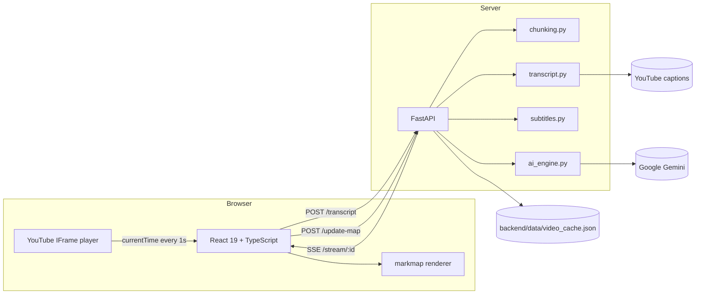
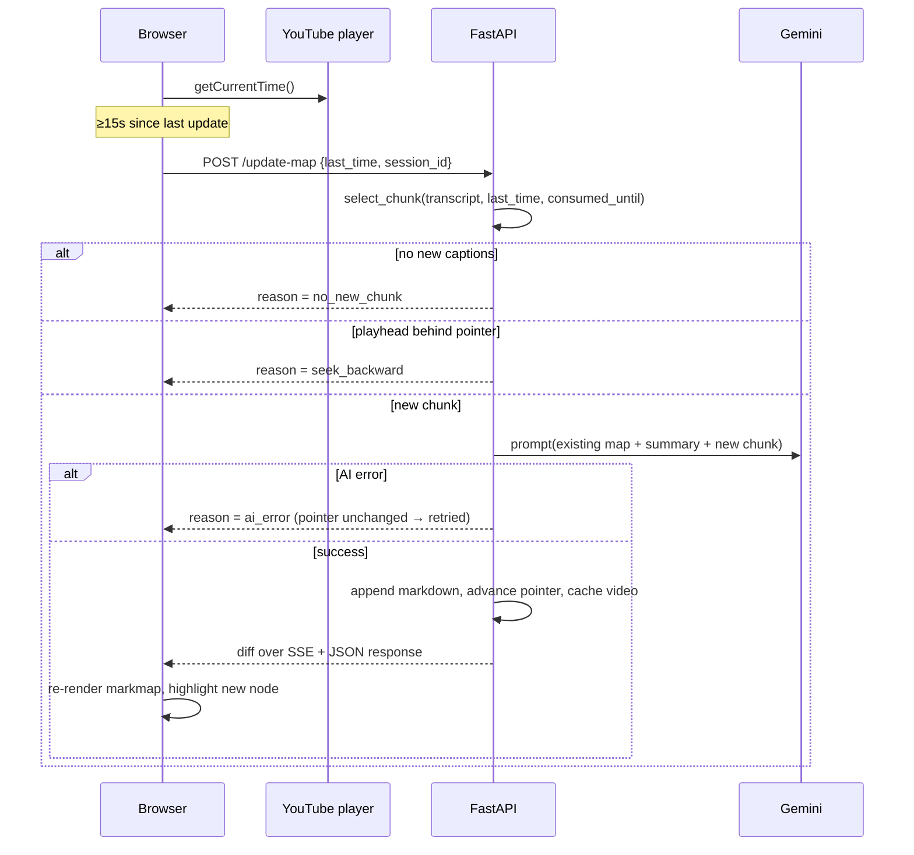

# Architecture

`yt-mindmap` turns a YouTube lecture into a mind map that grows **while** the
video plays. This document explains how the pieces fit together and why the
current design looks the way it does. Decisions with trade-offs are recorded as
[ADRs](./adr/).

## System overview



- The **browser owns playback**: it polls `player.getCurrentTime()` once per
  second and asks the backend for an update roughly every 15 seconds.
- The **server owns the map**: transcript, pointer (`consumed_until`), summary
  and accumulated Markdown all live in the session, so a page reload or a
  second tab cannot corrupt the map.
- **Gemini only sees new content**, plus a truncated map and a rolling summary.

## Live update sequence



## Invariants that keep cost and correctness in check

| Invariant | Where | Why |
|---|---|---|
| `consumed_until` only moves forward, and only after a successful AI call | `main.update_map` | A failed chunk is retried instead of silently lost |
| One AI request ≤ 180s or 300 caption entries | `chunking.select_chunk` | A far seek cannot create an unbounded prompt |
| Prompt ≤ 8k chars of transcript, ≤ 4k chars of map, ≤ 1.2k chars of summary | `ai_engine` | Bounded token cost per tick |
| Backward seeks are ignored inside a 3s tolerance | `chunking.is_seek_backward` | Re-watching does not re-pay for the same content |
| Sessions expire after 2h, capped at 100; cache capped at 50 videos | `main` | An unattended app cannot grow forever |
| Auth errors are not retried, transient ones are (3 attempts, 1/2/4s) | `ai_engine._generate_with_retry` | Do not burn quota on a bad key |

## Data model

```text
session
├── video_id            str | None
├── transcript          [{start, duration, text}]
├── consumed_until      float   # last second already mapped
├── summary_so_far      str     # rolling compact memory
├── markdown            str     # accumulated mind map
├── events              [diff]  # replay buffer for SSE
└── last_active         float   # TTL cleanup

video_cache[video_id]
├── markdown / summary_so_far / consumed_until
└── updated_at
```

The cache is written atomically (`.tmp` + `os.replace`) under a lock, so a crash
mid-write cannot corrupt the JSON.

## Frontend structure

- `src/App.tsx` — player, transcript loading, update loop, session recovery,
  race-condition guards (`loadTokenRef`, `sessionIdRef`, `isUpdatingRef`).
- `src/components/MindMap.tsx` — markmap lifecycle, new-node highlight,
  click-to-seek interception.
- `src/lib/mindmapTree.ts` — pure tree helpers (labels, new-node detection,
  branch folding); unit-tested without a DOM.

`MindMap` is lazy-loaded: markmap + d3 + katex + highlight.js are ~670 kB and
must not block the player shell. Vendor code is split into cacheable chunks in
`vite.config.ts`.

## Testing

- Backend: `pytest` covers chunk selection, seek rules, subtitle parsing, AI
  payload normalisation, cache persistence/eviction, and API behaviour (happy
  path, `session_lost`, `ai_error`, `seek_backward`).
- Frontend: `vitest` covers the pure tree helpers.
- CI runs lint + tests + production build on every push/PR to `main`/`develop`.

## Operations

- `GET /healthz` reports session count, cached videos and whether the AI key is
  configured (used by Docker's healthcheck).
- CORS origins come from `ALLOWED_ORIGINS` (comma separated).
- `docker compose up --build` runs nginx (port 8080) in front of FastAPI
  (port 8001) with a named volume for the cache.

## Known scaling limits

Single-process session store ⇒ one uvicorn worker. Horizontal scaling needs
Redis for sessions/pub-sub and a database for saved maps; that work is planned
together with accounts and collaboration.
