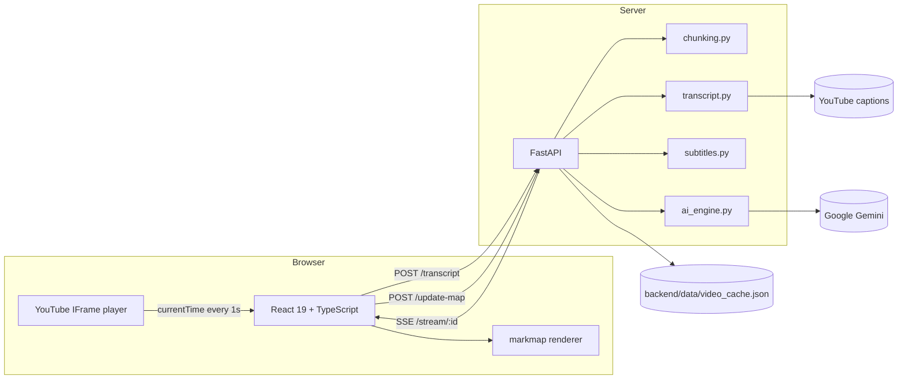
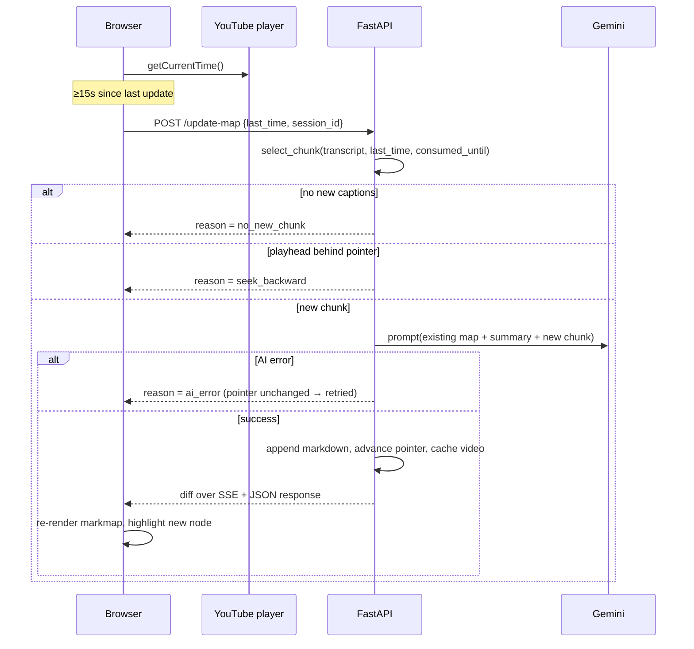

# Architecture

`yt-mindmap` turns a YouTube lecture into a mind map that grows **while** the
video plays. This document explains how the pieces fit together and why the
current design looks the way it does. Decisions with trade-offs are recorded as
[ADRs](./adr/).

## System overview



- The **browser owns playback**: it polls `player.getCurrentTime()` once per
  second and asks the backend for an update roughly every 15 seconds.
- The **server owns the map**: transcript, pointer (`consumed_until`), summary
  and accumulated Markdown all live in the session, so a page reload or a
  second tab cannot corrupt the map.
- **Gemini only sees new content**, plus a truncated map and a rolling summary.

## Live update sequence



## Invariants that keep cost and correctness in check

| Invariant | Where | Why |
|---|---|---|
| `consumed_until` only moves forward, and only after a successful AI call | `main.update_map` | A failed chunk is retried instead of silently lost |
| One AI request ≤ 180s or 300 caption entries | `chunking.select_chunk` | A far seek cannot create an unbounded prompt |
| Prompt ≤ 8k chars of transcript, ≤ 4k chars of map, ≤ 1.2k chars of summary | `ai_engine` | Bounded token cost per tick |
| Backward seeks are ignored inside a 3s tolerance | `chunking.is_seek_backward` | Re-watching does not re-pay for the same content |
| Sessions expire after 2h, capped at 100; cache capped at 50 videos | `main` | An unattended app cannot grow forever |
| Node ids are generated once and never reused; merging keeps the existing id and time | `node_tree.merge_nodes` | Pin/note/comment/undo need an address that survives updates |
| A label already present under the same parent absorbs the new children instead of duplicating the branch | `node_tree.merge_nodes` | The AI repeats concepts across chunk boundaries |
| The AI owns the structure; a user edit may rename, note and pin a node but never create, move or delete one | `main.edit_node`, `node_tree.update_node` | Two writers cannot fight over the same tree |
| A rename records the previous label as an alias, so an AI chunk using the old wording folds into the renamed node | `node_tree.update_node` | Editing a node must not make the AI duplicate it |
| A pinned branch is never folded by "focus recent" | `mindmapTree.collapseOlderBranches` | Pinning is the user saying "keep this in view" |
| Auth errors are not retried, transient ones are (3 attempts, 1/2/4s) | `ai_engine._generate_with_retry` | Do not burn quota on a bad key |
| Gemini thinking is disabled by default (`GEMINI_THINKING_BUDGET=0`) | `ai_engine._config` | Extraction is not reasoning-heavy, and updates run every ~15s |

## Data model

```text
session
├── video_id            str | None
├── transcript          [{start, duration, text}]
├── consumed_until      float   # last second already mapped
├── summary_so_far      str     # rolling compact memory
├── nodes               [node]  # source of truth for the mind map
├── markdown            str     # projection of `nodes`, rebuilt on every update
├── events              [diff]  # replay buffer for SSE
└── last_active         float   # TTL cleanup

node
├── id                  str     # uuid, stable for the life of the node
├── parentId            str | None
├── label               str
├── time                float | None   # video offset for click-to-seek
├── note                str     # user annotation, empty by default
├── pinned              bool    # exempt from "focus recent" folding
├── aliases             [str]   # previous labels, so merges still fold
├── updatedAt           float   # set by the last user edit
└── children            [node]

video_cache[video_id]
├── nodes / markdown / summary_so_far / consumed_until
└── updated_at
```

`nodes` is the map; `markdown` is derived by `node_tree.tree_to_markdown` and
kept only so the cache stays readable by an older client. Caches written before
the tree existed have no `nodes`, so `main.restore_nodes` re-parses their
Markdown with `markdown_to_tree` instead of dropping the map.

### Editing

`PATCH /node` is the only writer of user state. It takes a `session_id`, a
`node_id` and any of `label`, `note`, `pinned`; omitted fields are left alone,
so a pin toggle cannot clobber a note. Rules:

- `label` is optional but may not become empty (400); `note` may be cleared
  with `""`; `pinned` toggles both ways.
- A rename records the old label in `aliases`, capped at 8 entries. Merging
  indexes siblings by current label *and* aliases, so the next AI chunk that
  still says the old name folds into the renamed node instead of adding a
  duplicate.
- The endpoint never creates, moves or deletes nodes: structure belongs to the
  AI. Editing a node that has been removed returns 404 `node_not_found`.
- The whole tree comes back, and the same payload is appended to the session's
  events as a `node_edit` event, so other tabs on the session converge through
  the existing SSE stream.
- Edits are written to the video cache immediately, so a reload or a backend
  restart keeps them.

Notes travel to the browser as plain text and are escaped before they reach
markmap's HTML content; pins additionally set `payload.pinned`, which is what
`collapseOlderBranches` reads.

The cache is written atomically (`.tmp` + `os.replace`) under a lock, so a crash
mid-write cannot corrupt the JSON.

## Frontend structure

- `src/App.tsx` — player, transcript loading, update loop, session recovery,
  race-condition guards (`loadTokenRef`, `sessionIdRef`, `isUpdatingRef`), node
  editor panel (`patchNode`, `saveEditor`, `togglePin`).
- `src/components/MindMap.tsx` — markmap lifecycle, renders the tree directly
  (no Markdown parsing), new-node highlight, click-to-seek interception, and
  the selection outline.
- `src/lib/mindmapTree.ts` — pure tree helpers: node → markmap data (carrying
  `data-node-id`), new-node detection by id, branch folding, cache repair.

`MindMap` is lazy-loaded: the map renderer must not block the player shell.
Because the chunk can mount *after* a transcript arrives, `App` re-pushes its
tree through the `onReady` callback.

Clicking a node seeks to its timestamp (when it has one) *and* selects it,
which opens the editor. Selection is a `mm-selected` class on the markmap
group, applied without re-rendering so the view does not jump.

markmap rewrites every node's `class` on each render, and it also renders again
from its own `ResizeObserver` *after* `setData` resolves. Applying the class
once after a render therefore loses it a moment later. `MindMap` keeps a
`MutationObserver` on the SVG that re-applies the selection whenever classes
change; the observer re-adds a class only when it is missing, so it converges.

`markmap-lib` is no longer a dependency: `markmap-view` renders the tree directly,
so the browser no longer ships a Markdown parser, transformer, katex and
highlight.js. That cut the lazy chunk from 670 kB to 75 kB (231.7 kB → 25.4 kB
gzipped).

## Testing

- Backend: `pytest` covers chunk selection, seek rules, subtitle parsing, AI
  payload normalisation and retry policy, node ids/merge/dedupe, note and pin
  editing, cache persistence/eviction, and API behaviour (happy path,
  `session_lost`, `node_not_found`, `ai_error`, `seek_backward`).
- Frontend: `vitest` covers the pure tree helpers.
- CI runs lint + tests + production build on every push/PR to `main`/`develop`.

## Operations

- `GET /healthz` reports session count, cached videos, the configured model
  (used by Docker's healthcheck), the optional `GEMINI_BASE_URL` and cumulative
  token usage for the process.
- `GEMINI_BASE_URL` points the AI path at a mock or proxy instead of Google,
  which is how the AI-driven UI path is tested without spending quota.
- CORS origins come from `ALLOWED_ORIGINS` (comma separated).
- `docker compose up --build` runs nginx (port 8080) in front of FastAPI
  (port 8001) with a named volume for the cache.
- CI validates the images on every push: compose config is parsed, both images
  are built, the backend container must answer `/healthz`, and nginx must serve
  the SPA shell and its JS chunk.

## Known scaling limits

Single-process session store ⇒ one uvicorn worker. Horizontal scaling needs
Redis for sessions/pub-sub and a database for saved maps; that work is planned
together with accounts and collaboration.
