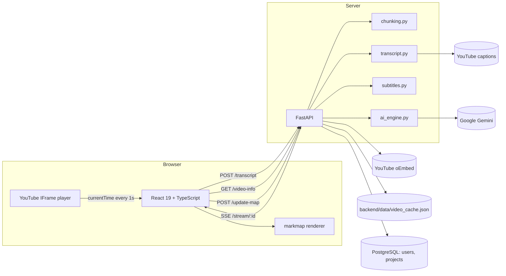
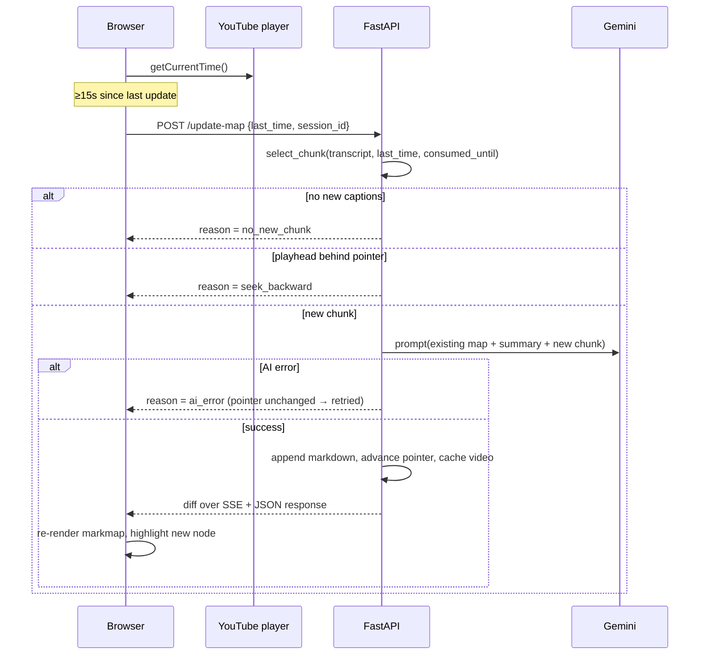

# Architecture

`yt-mindmap` turns a YouTube lecture into a mind map that grows **while** the
video plays. This document explains how the pieces fit together and why the
current design looks the way it does. Decisions with trade-offs are recorded as
[ADRs](./adr/).

## System overview



- The **browser owns playback**: it polls `player.getCurrentTime()` once per
  second and asks the backend for an update roughly every 15 seconds.
- The **server owns the map**: transcript, pointer (`consumed_until`), summary
  and accumulated Markdown all live in the session, so a page reload or a
  second tab cannot corrupt the map.
- **Gemini only sees new content**, plus a truncated map and a rolling summary.
- **Captions follow the video's own language.** `transcript.py` asks for the
  manually created track first and then the original auto-generated track, so a
  Vietnamese lecture never fails because an English track is missing. An
  explicit `lang` still takes priority when the caller sends one.
- **Playback and caption extraction are independent.** `/video-info` probes
  YouTube's oEmbed endpoint; a non-embeddable video still keeps its player
  notice and an "open on YouTube" link, and a captionless video still plays.
  YouTube's own rules (private, deleted, age/region, embedding disabled) cannot
  be overridden by the app.
- **Caption failures carry a stable `code`** (`no_transcript`,
  `transcripts_disabled`, `video_unavailable`, `ip_blocked`, …) inside
  `detail`, so the UI translates the reason instead of showing the library's
  stack trace.

## Live update sequence



## Invariants that keep cost and correctness in check

| Invariant | Where | Why |
|---|---|---|
| `consumed_until` only moves forward, and only after a successful AI call | `main.update_map` | A failed chunk is retried instead of silently lost |
| One AI request ≤ 180s or 300 caption entries | `chunking.select_chunk` | A far seek cannot create an unbounded prompt |
| Prompt ≤ 8k chars of transcript, ≤ 4k chars of map, ≤ 1.2k chars of summary | `ai_engine` | Bounded token cost per tick |
| Backward seeks are ignored inside a 3s tolerance | `chunking.is_seek_backward` | Re-watching does not re-pay for the same content |
| Sessions expire after 2h, capped at 100; cache capped at 50 videos | `main` | An unattended app cannot grow forever |
| Node ids are generated once and never reused; merging keeps the existing id and time | `node_tree.merge_nodes` | Pin/note/comment/undo need an address that survives updates |
| A label already present under the same parent absorbs the new children instead of duplicating the branch | `node_tree.merge_nodes` | The AI repeats concepts across chunk boundaries |
| The AI owns the structure; a user edit may rename, note and pin a node but never create, move or delete one | `main.edit_node`, `node_tree.update_node` | Two writers cannot fight over the same tree |
| A rename records the previous label as an alias, so an AI chunk using the old wording folds into the renamed node | `node_tree.update_node` | Editing a node must not make the AI duplicate it |
| A pinned branch is never folded by "focus recent" | `mindmapTree.collapseOlderBranches` | Pinning is the user saying "keep this in view" |
| Auth errors are not retried, transient ones are (3 attempts, 1/2/4s) | `ai_engine._generate_with_retry` | Do not burn quota on a bad key |
| Gemini thinking is disabled by default (`GEMINI_THINKING_BUDGET=0`) | `ai_engine._config` | Extraction is not reasoning-heavy, and updates run every ~15s |
| A signed-in session never writes the shared video cache | `main.cache_video_map` | Notes and pins must stay private per account |
| A saved project is never demoted to a draft, and a draft keeps its id | `services/projects.autosave` | Autosave must not undo an explicit save |

## Data model

```text
session
├── video_id            str | None
├── transcript          [{start, duration, text}]
├── consumed_until      float   # last second already mapped
├── summary_so_far      str     # rolling compact memory
├── nodes               [node]  # source of truth for the mind map
├── markdown            str     # projection of `nodes`, rebuilt on every update
├── events              [diff]  # replay buffer for SSE
└── last_active         float   # TTL cleanup

node
├── id                  str     # uuid, stable for the life of the node
├── parentId            str | None
├── label               str
├── time                float | None   # video offset for click-to-seek
├── note                str     # user annotation, empty by default
├── pinned              bool    # exempt from "focus recent" folding
├── aliases             [str]   # previous labels, so merges still fold
├── updatedAt           float   # set by the last user edit
└── children            [node]

video_cache[video_id]
├── nodes / markdown / summary_so_far / consumed_until
└── updated_at

projects                          # one row = one video (or subtitle file) + one map
├── id / user_id                  # user_id is the owner in every query
├── video_id                      # null when built from an uploaded file
├── title
├── nodes / transcript            # the row is authoritative on reopen
├── transcript_language
├── summary_so_far / consumed_until
├── is_draft                      # true = autosave, false = explicitly saved
├── visibility                    # private | unlisted | invited
├── link_role                     # viewer | editor, what the link grants
├── share_slug                    # YTMM-XXXXXXXX while sharing is on
├── last_opened_at
└── created_at / updated_at

project_members                  # invitations keyed by email, not user id
├── id / project_id
├── email                        # lower-cased; may not have an account yet
├── role                         # viewer | editor
└── created_at / updated_at
```

`nodes` is the map; `markdown` is derived by `node_tree.tree_to_markdown` and
kept only so the cache stays readable by an older client. Caches written before
the tree existed have no `nodes`, so `main.restore_nodes` re-parses their
Markdown with `markdown_to_tree` instead of dropping the map.

### Editing

`PATCH /node` is the only writer of user state. It takes a `session_id`, a
`node_id` and any of `label`, `note`, `pinned`; omitted fields are left alone,
so a pin toggle cannot clobber a note. Rules:

- `label` is optional but may not become empty (400); `note` may be cleared
  with `""`; `pinned` toggles both ways.
- A rename records the old label in `aliases`, capped at 8 entries. Merging
  indexes siblings by current label *and* aliases, so the next AI chunk that
  still says the old name folds into the renamed node instead of adding a
  duplicate.
- The endpoint never creates, moves or deletes nodes: structure belongs to the
  AI. Editing a node that has been removed returns 404 `node_not_found`.
- The whole tree comes back, and the same payload is appended to the session's
  events as a `node_edit` event, so other tabs on the session converge through
  the existing SSE stream.
- Edits are written to the video cache immediately, so a reload or a backend
  restart keeps them.

Notes travel to the browser as plain text and are escaped before they reach
markmap's HTML content; pins additionally set `payload.pinned`, which is what
`collapseOlderBranches` reads.

The cache is written atomically (`.tmp` + `os.replace`) under a lock, so a crash
mid-write cannot corrupt the JSON.

## Accounts and sessions

Accounts live in PostgreSQL; the mind-map session/cache layer above does not.

```text
users
├── id                  uuid (str)     primary key
├── email               str            unique, lower-cased
├── display_name        str            required (OAuth fills it from the profile)
├── password_hash       str | null     null for OAuth-only accounts
├── provider            str            "local" | "google" | "github"
├── provider_id         str | null     "google:<sub>" / "github:<id>", indexed
├── avatar_url          str | null
├── email_verified      bool
├── last_login_at       timestamptz | null
└── created_at / updated_at
```

Two tokens, two places:

| Token | Lifetime | Storage | Purpose |
|---|---|---|---|
| Access (JWT, `typ=access`) | 15 min | JS memory only | `Authorization: Bearer` on API calls |
| Refresh (JWT, `typ=refresh`) | 14 days | HttpOnly cookie | Trade for a new access token |

The access token is never persisted, so an XSS payload cannot read it from
`localStorage`; the refresh token cannot be read by JavaScript at all. Every
`/auth/refresh` rotates the cookie. A second, non-secret cookie (`ytmm_session=1`)
lets the SPA skip the refresh call on a first visit, which removes a guaranteed
401 from the console.

`POST /auth/refresh` returns only an access token; the user object comes from
`GET /auth/me`, so a page reload always re-reads the account from the database.

### OAuth

Both providers use the server-side authorization-code flow, implemented in
`app/services/oauth.py` and `app/api/routes/oauth.py`:

1. `GET /api/auth/{provider}` → 302 to the provider with a random `state`, also
   stored in an HttpOnly cookie scoped to `/api/auth` (10 min TTL).
2. `GET /api/auth/{provider}/callback` → compare state with `compare_digest`,
   exchange the code, read the profile, upsert the account.
3. The callback sets the same two session cookies as a password login and
   redirects to `/dashboard`; the SPA restores the session through
   `/auth/refresh` + `/auth/me`.

Any failure is a redirect to `/login?oauth=<provider>&error=<code>` — never a
JSON error page. Codes: `oauth_not_configured`, `oauth_denied`,
`oauth_state_mismatch`, `oauth_callback_missing_code`, `token_exchange_failed`,
`profile_fetch_failed`, `email_unavailable`, `email_unverified`,
`oauth_account_error`.

An OAuth profile whose email matches an existing password account is **linked**
(see `app/services/accounts.py`): the password keeps working, `provider` stays
`local`, and `provider_id` records the OAuth identity. Google and GitHub only
report verified addresses.

Routes that need a user depend on `app/api/deps.get_current_user`, which decodes
the access token and loads the row from the database, so a deleted account
immediately loses access. `get_optional_user` is the guest-friendly variant used
by `/transcript`; a request carrying a `project_id` still has to be the owner.

## Saved projects and drafts

A project is one video (or one uploaded `.srt`/`.vtt`) plus its map. The row
holds the transcript, nodes, summary and pointer, so reopening it rebuilds the
session without touching YouTube:

```text
POST /transcript {project_id}
  → owner check → create_session(nodes=row.nodes, transcript=row.transcript,
                                 resume_at=row.consumed_until,
                                 initial_summary=row.summary_so_far,
                                 use_cache=False)
  → last_opened_at = now
```

Persistence has two speeds:

- **Autosave (signed in).** After a branch is added or the pointer moves, the
  workspace debounces for ~2.5s and posts `{session_id, project_id?}` to
  `POST /api/projects/autosave`. The server copies the live session into a row,
  creating `is_draft=true` the first time and reusing the newest draft for that
  video afterwards. The explicit "Lưu dự án" dialog sends a title and
  `PATCH {is_draft:false}`. A later autosave never demotes a saved project and
  never rewrites its title.
- **Guest draft.** Anonymous sessions write `ytmm:guest-draft` in
  `localStorage` (title, nodes, pointer, language, url; no transcript). A banner
  restores it by re-fetching captions and posting the saved `initial_nodes` and
  `resume_at`. Signing in clears the local copy.

Notes and pins are part of `nodes`, so they travel with the project and are
private per account. `cache_video_map` returns early for sessions that have an
`owner_id`; guests keep the shared `video_cache`. That is what closes the
cross-account note leak without adding a second table.

Ownership lives in `app/services/projects.py`: every query filters by
`user_id`, so a foreign project id returns 404 exactly like a missing one.
`/api/projects` exposes CRUD, `/stats` (saved, drafts, shared, shared-with-me,
recent), `/{id}/duplicate`, and the owner-only share/member routes; lists never
ship the transcript.

```text
/api/projects
├── GET    ?draft=&q=&limit=&offset=   list (owned, newest first)
├── GET    /stats                      counts + 5 recent saved projects
├── GET    /shared                     projects where my email is a member
├── POST   /                           create
├── GET    /{id}                       detail (nodes + transcript)
├── PATCH  /{id}                       title, is_draft, visibility, nodes…
├── DELETE /{id}                       204; permanent, owner only
├── POST   /{id}/duplicate             copy without a share slug
├── POST   /autosave                   {session_id, project_id?, title?, is_draft?}
├── GET    /{id}/share                 owner-only settings + members
├── PUT    /{id}/share                 {enabled, access: anyone|invited, role}
├── POST   /{id}/share/rotate          replace the slug (old link dies)
├── GET    /{id}/members               owner-only invite list
├── POST   /{id}/members               {email, role}
├── PATCH  /{id}/members/{member_id}   change a member role
└── DELETE /{id}/members/{member_id}   204

/api/share/{slug}                     public read; resolves role, can_edit,
                                      requires_login, owner_name, session_id
```

Sharing rules live in `app/services/sharing.py`. `visibility` is `private`
(owner only), `unlisted` (anyone with the slug gets `link_role`) or `invited`
(only `project_members` emails get their member role). Anonymous callers can
only read a public `unlisted` link; editing always needs a signed-in user.
Turning sharing off clears the slug, and re-enabling or rotating always
allocates a new `YTMM-XXXXXXXX` value.

`POST /transcript` with a `project_id` is opened by any role, and
`find_project_session` reuses one live session per project so every editor
receives the same SSE `node_edit` and AI `diff` events. `/node` and
`/update-map` resolve the caller's role from the session's project:
viewers get 403 `project_read_only`, editors and the owner may write, and an
anonymous caller gets 401. A per-session lock makes only one editor run the AI
for a given transcript chunk. Only the owner may rename/delete the project or
change sharing; editor autosave writes the map fields but ignores a supplied
title.

## Frontend structure

- `src/router.tsx` — `/` (landing), `/login`, `/register`, `/app` (workspace,
  no account needed), `/app/:projectId` (reopen a saved or shared project,
  guarded), `/s/:slug` (public read-only share page) and `/dashboard` behind
  `ProtectedRoute`.
- `src/context/AuthContext.tsx` — session restore (`ytmm_session` hint →
  `/auth/refresh` → `/auth/me`), `login`, `register`, `logout`.
- `src/lib/api.ts` — API base, in-memory access token, one silent refresh +
  replay on 401, `ApiError`/`errorCode` helpers.
- `src/lib/projects.ts` — project + sharing API client/types (`ShareSettings`,
  `SharedProjectView`, `shareUrl`, `parseShareSlug`), `formatWhen`, and the
  `ytmm:guest-draft` localStorage helpers.
- `src/pages/Auth/` — combined login/register page with the mascot, plus
  `OAuthButtons`, which asks `/auth/providers` and only enables providers the
  server can handle.
- `src/pages/Dashboard/` — real overview (stats + recent), saved projects and
  drafts lists with search, rename, duplicate, delete and promote, a
  “Được chia sẻ” list, the join-by-link form and `ShareDialog` (toggle, link
  role, invite-only mode, copy/rotate link, email invites and member roles).
- `src/pages/SharedProject/` — `/s/:slug` read-only page: project snapshot,
  optional live SSE updates, player with click-to-seek, login prompt for an
  invite-only link and “Mở để chỉnh sửa” for editors.
- `src/pages/Workspace/index.tsx` — player, transcript loading, update loop,
  session recovery, race-condition guards (`loadTokenRef`, `sessionIdRef`,
  `isUpdatingRef`), role-aware read-only mode (`role`, `canEdit`), node editor
  panel (`patchNode`, `saveEditor`, `togglePin`), plus autosave, the save dialog
  and the guest draft banner. `/node` and `/update-map` attach the bearer token
  through `sessionRequest`.
- `src/lib/youtube.ts` — pure YouTube helpers used by the workspace and tests:
  URL/ID parsing (`watch`, `youtu.be`, `shorts`, `embed`, `live`, bare ID),
  transcript error codes → Vietnamese copy, and player error codes
  (2/5/100/101/150/153) → explanatory notice.
- `src/components/MindMap.tsx` — markmap lifecycle, renders the tree directly
  (no Markdown parsing), new-node highlight, click-to-seek interception, and
  the selection outline.
- `src/lib/mindmapTree.ts` — pure tree helpers: node → markmap data (carrying
  `data-node-id`), new-node detection by id, branch folding, cache repair.

`MindMap` is lazy-loaded: the map renderer must not block the player shell.
Because the chunk can mount *after* a transcript arrives, `App` re-pushes its
tree through the `onReady` callback.

Clicking a node seeks to its timestamp (when it has one) *and* selects it,
which opens the editor. Selection is a `mm-selected` class on the markmap
group, applied without re-rendering so the view does not jump.

markmap rewrites every node's `class` on each render, and it also renders again
from its own `ResizeObserver` *after* `setData` resolves. Applying the class
once after a render therefore loses it a moment later. `MindMap` keeps a
`MutationObserver` on the SVG that re-applies the selection whenever classes
change; the observer re-adds a class only when it is missing, so it converges.

`markmap-lib` is no longer a dependency: `markmap-view` renders the tree directly,
so the browser no longer ships a Markdown parser, transformer, katex and
highlight.js. That cut the lazy chunk from 670 kB to 75 kB (231.7 kB → 25.4 kB
gzipped).

## Testing

- Backend: `pytest` covers chunk selection, seek rules, subtitle parsing, AI
  payload normalisation and retry policy, node ids/merge/dedupe, note and pin
  editing, cache persistence/eviction, and API behaviour (happy path,
  `session_lost`, `node_not_found`, `ai_error`, `seek_backward`). Auth tests
  (`tests/test_auth.py`, `tests/test_oauth.py`) run on an in-memory SQLite
  database injected via `app.dependency_overrides[get_db]`; the OAuth tests stub
  the provider HTTP calls, so no credentials or network are needed.
  `tests/test_projects.py` covers CRUD, ownership isolation, draft/saved
  separation, search, autosave reuse, cache isolation and reopening without
  YouTube.
- Frontend: `vitest` covers the pure tree helpers, YouTube URL/error helpers and
  `formatWhen`.
- CI runs lint + tests + production build on every push/PR to `main`/`develop`.

## Operations

- `GET /healthz` reports session count, cached videos, the configured model
  (used by Docker's healthcheck), the optional `GEMINI_BASE_URL` and cumulative
  token usage for the process.
- `GET /video-info?url=` returns `{video_id, title, author_name,
  thumbnail_url, embeddable, checked, reason}` from oEmbed. `embeddable` is
  `null` when oEmbed could not be reached (the player is still attempted).
- `GEMINI_BASE_URL` points the AI path at a mock or proxy instead of Google,
  which is how the AI-driven UI path is tested without spending quota.
- CORS origins come from `ALLOWED_ORIGINS` (comma separated).
- `docker compose up --build` runs nginx (port 8080) in front of FastAPI
  (port 8001) with a named volume for the cache.
- CI validates the images on every push: compose config is parsed, both images
  are built, the backend container must answer `/healthz`, and nginx must serve
  the SPA shell and its JS chunk.

## Known scaling limits

Single-process session store ⇒ one uvicorn worker. Accounts, saved projects and
project memberships live in PostgreSQL, but the live session, SSE buffer and
guest cache are still per process; horizontal scaling needs Redis for
sessions/pub-sub. Sharing reuses that same live session: every editor of a
project watches one SSE stream, and a per-session lock serialises AI updates.
Conflicts are last-write-wins per edit; presence cursors and CRDT/OT merge are
future work.
